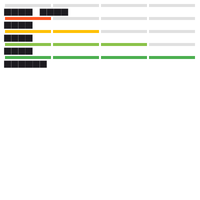

# 09 · Testing: Unit, Widget & Golden Tests

You've been running widget tests since Level 1 to *show* behaviour. This lesson is about writing tests on
purpose: what each kind is for, how to control time and dependencies, and how golden tests catch visual
regressions. Everything below was run with `flutter test` on Flutter 3.44.8.

| Kind | Tests | Runs on | Speed |
|---|---|---|---|
| Unit (`test`) | a function or class, no widgets | the Dart VM | milliseconds |
| Widget (`testWidgets`) | a widget subtree, rendered headlessly | the Dart VM, fake clock | tens of ms |
| Golden (`matchesGoldenFile`) | a widget's *pixels* against a stored PNG | the Dart VM | tens of ms |
| Integration (`integration_test`) | the whole app on a device/emulator | a real device | seconds–minutes |

Integration tests are [Level 3 · 09](../level-3/09-integration-tests.md). The first three run on your laptop and in CI
with no device, so they should carry most of your coverage.

## The code under test

A signup form with a password-strength meter. The scoring is a pure function (easy to unit test); the form depends on
a `SignupService` interface (easy to fake).

```dart title="testing_demo.dart"
import 'package:flutter/material.dart';

/// Pure logic: password strength from 0 to 4.
int passwordScore(String p) {
  var score = 0;
  if (p.length >= 8) score++;
  if (p.length >= 12) score++;
  if (RegExp(r'[A-Z]').hasMatch(p) && RegExp(r'[a-z]').hasMatch(p)) score++;
  if (RegExp(r'[0-9]').hasMatch(p) && RegExp(r'[^A-Za-z0-9]').hasMatch(p)) score++;
  return score;
}

const labels = ['Very weak', 'Weak', 'Fair', 'Good', 'Strong'];

/// Something with a side effect we don't want in widget tests.
abstract class SignupService {
  Future<bool> register(String email, String password);
}

class SignupForm extends StatefulWidget {
  const SignupForm({super.key, required this.service});
  final SignupService service;
  @override
  State<SignupForm> createState() => _SignupFormState();
}

class _SignupFormState extends State<SignupForm> {
  final _email = TextEditingController();
  final _password = TextEditingController();
  bool _busy = false;
  String? _result;

  @override
  void dispose() {
    _email.dispose();
    _password.dispose();
    super.dispose();
  }

  Future<void> _submit() async {
    setState(() => _busy = true);
    final ok = await widget.service.register(_email.text.trim(), _password.text);
    if (!mounted) return;
    setState(() {
      _busy = false;
      _result = ok ? 'Welcome!' : 'That email is taken';
    });
  }

  @override
  Widget build(BuildContext context) {
    final score = passwordScore(_password.text);
    return Padding(
      padding: const EdgeInsets.all(16),
      child: Column(crossAxisAlignment: CrossAxisAlignment.stretch, children: [
        TextField(key: const Key('email'), controller: _email, decoration: const InputDecoration(labelText: 'Email')),
        TextField(
          key: const Key('password'),
          controller: _password,
          obscureText: true,
          decoration: const InputDecoration(labelText: 'Password'),
          onChanged: (_) => setState(() {}),
        ),
        const SizedBox(height: 8),
        StrengthMeter(score: score),
        const SizedBox(height: 8),
        FilledButton(
          onPressed: score >= 3 && !_busy ? _submit : null,
          child: _busy ? const Text('Creating…') : const Text('Create account'),
        ),
        if (_result != null) Text(_result!, key: const Key('result')),
      ]),
    );
  }
}

class StrengthMeter extends StatelessWidget {
  const StrengthMeter({super.key, required this.score});
  final int score;
  @override
  Widget build(BuildContext context) {
    final colors = [Colors.red, Colors.deepOrange, Colors.amber, Colors.lightGreen, Colors.green];
    return Column(crossAxisAlignment: CrossAxisAlignment.start, children: [
      Row(children: [
        for (var i = 0; i < 4; i++)
          Expanded(
            child: Container(
              height: 6,
              margin: const EdgeInsets.symmetric(horizontal: 2),
              color: i < score ? colors[score] : Colors.grey.shade300,
            ),
          ),
      ]),
      Text(labels[score]),
    ]);
  }
}
```

## Unit tests: table-driven

```dart title="test/password_score_test.dart"
import 'package:flutter_test/flutter_test.dart';
import 'package:l2/s/testing_demo.dart';

void main() {
  group('passwordScore', () {
    final cases = {
      '': 0,
      'abc': 0,
      'abcdefgh': 1,
      'abcdefghijkl': 2,
      'Abcdefgh': 2,
      'Abcdefgh1!': 3,
      'Abcdefghijk1!': 4,
      '1234567!': 2, // length + digit/symbol; no letters, so the case rule adds nothing
    };
    cases.forEach((input, expected) {
      test('"$input" -> $expected', () => expect(passwordScore(input), expected));
    });
  });
}
```

A map of input → expected output generates one named test per case, so a failure tells you exactly which input
broke. It earned its keep immediately. The first version of this file expected `'1234567!'` to score **1**, with the
comment "no letters: the case rule fails". The run said otherwise:

```console
00:00 +7 -1: test/t/password_score_test.dart: passwordScore "1234567!" -> 1 [E]
  Expected: <1>
    Actual: <2>
```

The function was right and the expectation was wrong: eight characters earns the length point, and the digit+symbol
rule doesn't care about letters. Tests check your *understanding* as much as your code; when one fails, decide which
was wrong before "fixing" anything. The corrected case is in the file above.

## Widget tests: fakes and controlled completion

```dart title="test/signup_form_test.dart"
import 'dart:async';
import 'package:flutter/material.dart';
import 'package:flutter_test/flutter_test.dart';
import 'package:l2/s/testing_demo.dart';

/// A hand-written fake: records calls, lets the test decide when and how they finish.
class FakeSignupService implements SignupService {
  final calls = <String>[];
  final completer = Completer<bool>();
  @override
  Future<bool> register(String email, String password) {
    calls.add(email);
    return completer.future;
  }
}

void main() {
  late FakeSignupService service;
  Future<void> pumpForm(WidgetTester tester) async {
    service = FakeSignupService();
    await tester.pumpWidget(MaterialApp(home: Scaffold(body: SignupForm(service: service))));
  }

  FilledButton button(WidgetTester t) => t.widget<FilledButton>(find.byType(FilledButton));

  testWidgets('button is disabled until the password is good enough', (tester) async {
    await pumpForm(tester);
    expect(button(tester).onPressed, isNull);
    await tester.enterText(find.byKey(const Key('password')), 'Abcdefgh');
    await tester.pump();
    expect(find.text('Fair'), findsOneWidget);
    expect(button(tester).onPressed, isNull);
    await tester.enterText(find.byKey(const Key('password')), 'Abcdefgh1!');
    await tester.pump();
    expect(find.text('Good'), findsOneWidget);
    expect(button(tester).onPressed, isNotNull);
  });

  testWidgets('submitting shows progress, then the result', (tester) async {
    await pumpForm(tester);
    await tester.enterText(find.byKey(const Key('email')), '  ada@example.com ');
    await tester.enterText(find.byKey(const Key('password')), 'Abcdefgh1!');
    await tester.pump();
    await tester.tap(find.text('Create account'));
    await tester.pump();
    expect(find.text('Creating…'), findsOneWidget);
    expect(button(tester).onPressed, isNull, reason: 'no double submits');
    expect(service.calls, ['ada@example.com']);

    service.completer.complete(false);
    await tester.pump();
    expect(find.text('That email is taken'), findsOneWidget);
    expect(find.text('Create account'), findsOneWidget);
  });
}
```

The useful technique is the `Completer` inside `FakeSignupService`. The fake returns a future that **the test** decides
when to complete, so the test can stop in the middle of the submission and assert on the in-between state ("Creating…",
button disabled, exactly one call with the trimmed email) before letting it finish with `complete(false)`. A fake that
returned immediately could never observe the loading state.

Prefer hand-written fakes like this for small interfaces: they're plain Dart and easy to read. `mocktail` is a popular
package when you need to verify many interactions or stub large interfaces without writing a class.

```console
$ flutter test test/t/password_score_test.dart test/t/signup_form_test.dart
00:00 +10: All tests passed!
```

## Golden tests: the pixels themselves

```dart title="test/strength_golden_test.dart"
import 'package:flutter/material.dart';
import 'package:flutter_test/flutter_test.dart';
import 'package:l2/s/testing_demo.dart';

void main() {
  testWidgets('StrengthMeter looks right at every score', (tester) async {
    tester.view.physicalSize = const Size(400, 400);
    tester.view.devicePixelRatio = 1;
    addTearDown(tester.view.reset);
    await tester.pumpWidget(MaterialApp(
      debugShowCheckedModeBanner: false,
      home: Scaffold(
        body: RepaintBoundary(
          key: const Key('meters'),
          child: Padding(
            padding: const EdgeInsets.all(8),
            child: Column(children: [for (var s = 0; s <= 4; s++) StrengthMeter(score: s)]),
          ),
        ),
      ),
    ));
    await expectLater(find.byKey(const Key('meters')), matchesGoldenFile('goldens/strength_meter.png'));
  });
}
```

The first run has nothing to compare against and fails:

```console
$ flutter test test/t/strength_golden_test.dart
Expected: one widget whose rasterized image matches golden image "goldens/strength_meter.png"
   Which: Could not be compared against non-existent file: "goldens/strength_meter.png"
```

Generate the reference image, look at it, and commit it:

```console
$ flutter test test/t/strength_golden_test.dart --update-goldens
00:00 +1: All tests passed!
```



The labels are rendered as rows of solid boxes. That's deliberate: by default, widget tests use a test font whose glyphs
are filled rectangles, so goldens don't change when system fonts differ between machines. (You can load real fonts in
tests if you need them visible.) The bars themselves are the real colours.

Then I changed one colour in `StrengthMeter` — `Colors.green` to `Colors.teal` for the "Strong" state — and ran the test
again:

```console
$ flutter test test/t/strength_golden_test.dart
Golden "goldens/strength_meter.png": Pixel test failed, 1.38%, 2208px diff detected.
Failure feedback can be found at
test/t/failures
```

The `failures/` folder contained `strength_meter_masterImage.png`, `strength_meter_testImage.png`,
`strength_meter_isolatedDiff.png` and `strength_meter_maskedDiff.png` — the expected image, the actual image, and two
diff visualizations to show *where* it changed. If the change was intended, rerun with `--update-goldens` and commit the
new image; that makes visual changes reviewable in a pull request.

Golden caveat: rendering can differ slightly between operating systems and Flutter versions (anti-aliasing,
GPU-independent but platform-specific font and path rasterization). Generate and compare goldens on one platform — usually
the CI's — or a teammate on another OS will see spurious failures.

## What to test where

- **Logic** (calculations, validation, parsing, state transitions) → unit tests. Most of your tests.
- **Wiring** (does the button call the service, does the error show, is the button disabled while busy) → widget tests
  with fakes.
- **Appearance of design-system components** → a few goldens, at a fixed size, in light and dark themes.
- **Real platform behaviour** (plugins, permissions, performance) → integration tests, sparingly.

## How It Actually Works

`flutter test` compiles each test file and runs it in a Dart VM with `TestWidgetsFlutterBinding`, a binding that
replaces the real engine connection with test doubles: there is no GPU and no window, frames happen only when you call
`pump`, and `tester.view` describes a virtual screen (800×600 logical pixels at device pixel ratio 3.0 by default; the
golden test overrides it). Timers and microtasks run inside a `FakeAsync` zone, so `pump(Duration)` *advances* time rather
than waiting for it.

`matchesGoldenFile` asks the engine's software rasterizer to paint the nearest `RepaintBoundary` layer into an image, then
hands it to `goldenFileComparator`. The default `LocalFileComparator` compares the PNG byte-for-byte after decoding; on
mismatch it computes the percentage of differing pixels and writes the diff images. You can install a custom comparator
(for example, one with a tolerance) in a `flutter_test_config.dart` file next to your tests.

## Common mistakes

- **Testing implementation, not behaviour** — asserting on private state or widget structure that refactors will change.
  Find what the user sees (`find.text`, semantics labels, keys on important elements).
- **`pumpAndSettle` everywhere.** It's for animations; it times out with infinite animations and hides timing bugs. Use
  `pump()` and explicit durations when you mean them.
- **Fakes that complete immediately**, making loading and race conditions untestable. Use a `Completer`.
- **Real network or disk in widget tests.** Inject fakes; keep tests deterministic.
- **Regenerating goldens without looking at them.** `--update-goldens` makes the test pass by definition.
- **Expecting exactly one widget when a `TextField` label also matches** `find.text` — make finders specific with keys.

## Exercise

1. Add a rule: passwords containing the email's local part (before `@`) score 0. Write the table-driven cases *first*, watch
   them fail, then implement.
2. Test the race: submit, then replace the form with an empty `SizedBox` before completing the fake. No exceptions should
   be thrown (the `mounted` check).
3. Add a dark-theme golden for the meter. Did any pixels besides the background change? Why?
4. Write a `flutter_test_config.dart` that sets a tolerant comparator (e.g. 0.5 % difference allowed) and explain when that
   would be appropriate and when it would hide real bugs.
