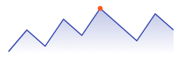

# 03 · CustomPainter & Drawing

Sometimes no combination of widgets produces what you need: a chart, a signature pad, a gauge, a custom progress ring.
`CustomPaint` gives you a `Canvas` and a size and lets you draw anything — lines, paths, shapes, gradients, text, images.
This lesson builds a sparkline chart, unit-tests its math, measures when it repaints (with a surprise), makes it visible
to screen readers, and locks its appearance with a golden test.

## The sparkline

```dart title="painter_demo.dart"
import 'dart:math' as math;
import 'package:flutter/material.dart';

/// A sparkline with a highlighted maximum and a filled area under the line.
class Sparkline extends StatelessWidget {
  const Sparkline({super.key, required this.values, this.color = Colors.indigo});
  final List<double> values;
  final Color color;

  @override
  Widget build(BuildContext context) => Semantics(
        // A canvas is invisible to screen readers unless you describe it.
        label: 'Trend of ${values.length} values, from ${values.first} to ${values.last}, peak ${values.reduce(math.max)}',
        child: CustomPaint(
          size: const Size(double.infinity, 80),
          painter: SparklinePainter(values: values, color: color),
        ),
      );
}

class SparklinePainter extends CustomPainter {
  SparklinePainter({required this.values, required this.color});
  final List<double> values;
  final Color color;

  /// Maps data index/value to canvas coordinates. Public so it can be unit-tested.
  static List<Offset> project(List<double> values, Size size, {double padding = 4}) {
    final minV = values.reduce(math.min), maxV = values.reduce(math.max);
    final range = maxV - minV == 0 ? 1.0 : maxV - minV;
    final w = size.width - 2 * padding, h = size.height - 2 * padding;
    return [
      for (var i = 0; i < values.length; i++)
        Offset(
          padding + (values.length == 1 ? w / 2 : w * i / (values.length - 1)),
          padding + h * (1 - (values[i] - minV) / range), // canvas y grows downward
        ),
    ];
  }

  @override
  void paint(Canvas canvas, Size size) {
    if (values.length < 2) return;
    final pts = project(values, size);

    final line = Path()..moveTo(pts.first.dx, pts.first.dy);
    for (final p in pts.skip(1)) {
      line.lineTo(p.dx, p.dy);
    }
    final area = Path.from(line)
      ..lineTo(pts.last.dx, size.height)
      ..lineTo(pts.first.dx, size.height)
      ..close();

    canvas.drawPath(
      area,
      Paint()
        ..shader = LinearGradient(
          begin: Alignment.topCenter,
          end: Alignment.bottomCenter,
          colors: [color.withValues(alpha: 0.35), color.withValues(alpha: 0.0)],
        ).createShader(Offset.zero & size),
    );
    canvas.drawPath(
      line,
      Paint()
        ..color = color
        ..style = PaintingStyle.stroke
        ..strokeWidth = 2
        ..strokeJoin = StrokeJoin.round,
    );
    final peak = values.indexOf(values.reduce(math.max));
    canvas.drawCircle(pts[peak], 4, Paint()..color = Colors.deepOrange);
    paints++;
  }

  /// Counts paint() calls across all instances, so tests can observe repaints.
  static int paints = 0;

  @override
  bool shouldRepaint(SparklinePainter old) => old.color != color || !_sameValues(old.values, values);

  static bool _sameValues(List<double> a, List<double> b) {
    if (identical(a, b)) return true;
    if (a.length != b.length) return false;
    for (var i = 0; i < a.length; i++) {
      if (a[i] != b[i]) return false;
    }
    return true;
  }
}
```

The anatomy of a painter:

- **`paint(Canvas canvas, Size size)`** draws. The origin is the top-left of the `CustomPaint`'s box, x grows right and
  **y grows down** — hence `1 - normalized` when mapping values to heights.
- **`Paint`** objects carry style: colour or `shader`, `style` (fill/stroke), `strokeWidth`, joins and caps.
- **`Path`** builds shapes from `moveTo`/`lineTo`/`quadraticBezierTo`/`arcTo`… The area fill reuses the line path
  (`Path.from`) and closes it along the bottom edge.
- **`shouldRepaint(old)`** is asked whenever a *new painter instance* is given to the `CustomPaint`. Return `true` only if
  what you'd draw has changed. Comparing values element by element matters: the caller will usually pass a new `List` each
  build, so `!=` on the lists would always be `true`.
- **The math is a pure static function** (`project`) — the most bug-prone part is testable without a canvas.

## Tests

```dart title="painter_test.dart"
import 'package:flutter/material.dart';
import 'package:flutter_test/flutter_test.dart';
import 'package:l2/a/painter_demo.dart';

void main() {
  test('project(): data space -> canvas space', () {
    final pts = SparklinePainter.project([10, 30, 20], const Size(108, 58));
    print(pts.map((o) => '(${o.dx}, ${o.dy})').join(' '));
    print('flat line: ${SparklinePainter.project([5, 5], const Size(108, 58)).map((o) => o.dy).toList()}');
  });

  testWidgets('repaints only when the data changes', (tester) async {
    Widget app(List<double> v, String title, {bool boundary = false}) => MaterialApp(
          home: Scaffold(
            appBar: AppBar(title: Text(title)),
            body: boundary ? RepaintBoundary(child: Sparkline(values: v)) : Sparkline(values: v),
          ),
        );
    SparklinePainter.paints = 0;
    await tester.pumpWidget(app([1, 3, 2, 5, 4], 'a'));
    print('first frame: ${SparklinePainter.paints} paint');
    await tester.pumpWidget(app([1, 3, 2, 5, 4], 'b')); // new list, same values; title changed
    print('same values, new list: ${SparklinePainter.paints} paints');
    await tester.pumpWidget(app([1, 3, 2, 5, 9], 'b'));
    print('changed value: ${SparklinePainter.paints} paints');

    // Same experiment with the chart in its own layer.
    await tester.pumpWidget(const SizedBox());
    SparklinePainter.paints = 0;
    await tester.pumpWidget(app([1, 3, 2, 5, 4], 'a', boundary: true));
    await tester.pumpWidget(app([1, 3, 2, 5, 4], 'b', boundary: true));
    print('with RepaintBoundary, title changed: ${SparklinePainter.paints} paint');
    await tester.pumpWidget(app([1, 3, 2, 5, 9], 'b', boundary: true));
    print('with RepaintBoundary, value changed: ${SparklinePainter.paints} paints');
  });

  testWidgets('semantics label for screen readers', (tester) async {
    final handle = tester.ensureSemantics();
    await tester.pumpWidget(const MaterialApp(home: Sparkline(values: [12, 18, 9, 22])));
    print(tester.getSemantics(find.byType(CustomPaint).last).label);
    handle.dispose();
  });

  testWidgets('golden', (tester) async {
    tester.view.physicalSize = const Size(300, 100);
    tester.view.devicePixelRatio = 1;
    addTearDown(tester.view.reset);
    await tester.pumpWidget(const MaterialApp(
      debugShowCheckedModeBanner: false,
      home: Scaffold(body: RepaintBoundary(key: Key('g'), child: Padding(padding: EdgeInsets.all(10), child: Sparkline(values: [3, 7, 4, 9, 6, 11, 8, 5, 10, 7])))),
    ));
    await expectLater(find.byKey(const Key('g')), matchesGoldenFile('goldens/sparkline.png'));
  });
}
```

```console
$ flutter test test/a/painter_test.dart
(4.0, 54.0) (54.0, 4.0) (104.0, 29.0)
flat line: [54.0, 54.0]
first frame: 1 paint
same values, new list: 2 paints
changed value: 3 paints
with RepaintBoundary, title changed: 1 paint
with RepaintBoundary, value changed: 2 paints
Trend of 4 values, from 12.0 to 22.0, peak 22.0
00:00 +4: All tests passed!
```

**Projection.** With a 108×58 canvas and 4 px padding, the drawable area is 100×50. The minimum (10) lands at the bottom
(y=54), the maximum (30) at the top (y=4), and 20 exactly halfway (y=29). A flat series doesn't divide by zero — the
`range == 0` guard puts it on the bottom line.

**The surprise: `shouldRepaint` returned `false`, and it repainted anyway.** Rebuilding with an equal list *and a new
AppBar title* gave a second paint. `shouldRepaint` only controls whether *this painter's change* requests a repaint. But
painting happens per **layer**: the AppBar title and the chart were in the same layer, so when the title's text changed and
its layer was repainted, every render object in that layer painted again — including our chart. Wrapping the chart in a
`RepaintBoundary` gives it its own layer: after that, a title change caused no chart paint (`1` is from the first frame),
and only the real data change did (`2`).

`RepaintBoundary` isn't free — each layer costs memory and compositing time — so use it around things that are expensive to
paint *and* change at a different rate from their surroundings: charts, animations next to static content, a canvas the
user draws on. Flutter DevTools' "Highlight repaints" toggle shows which areas repaint each frame
([Level 4 · 02](../level-4/02-performance.md)).

**Semantics.** A canvas is pixels; a screen reader has nothing to read. The `Semantics(label: ...)` wrapper describes the
chart's content in words. (`CustomPainter` also has a `semanticsBuilder` for painters that contain several separately
focusable regions.)

**Golden.** The golden test renders the chart at a fixed size:



The gradient, the stroke joins and the peak marker are all locked in. A change to `project` that, say, inverted the y-axis
would fail this test even if every unit test still passed.

## Other things a canvas can do

- `canvas.drawArc`, `drawRRect`, `drawOval`, `drawImage`, `drawParagraph` (text via `TextPainter`), `drawVertices`.
- `canvas.save()` / `translate` / `rotate` / `scale` / `restore()` to draw in a transformed coordinate space — for gauges and
  dials it's easier to rotate the canvas than to compute every point with trigonometry.
- `canvas.clipPath` / `clipRect` to restrict drawing.
- `Paint.maskFilter = MaskFilter.blur(...)` for soft shadows; `BlendMode`s for compositing effects.
- `CustomPaint(foregroundPainter: ...)` paints *over* its child; `painter:` paints behind it.
- For per-frame animation, pass the `Animation` as the painter's `repaint:` argument (`super(repaint: animation)`) — the
  painter then repaints on each tick **without rebuilding any widgets**.

## How It Actually Works

`CustomPaint` creates a `RenderCustomPaint`. In the paint phase, the framework walks render objects that need painting and
gives each a `PaintingContext` with a `Canvas` that *records* drawing commands into a `Picture` (a display list) — nothing
is rasterized yet. Pictures are attached to a tree of **layers**. A `RepaintBoundary` (or any render object with
`isRepaintBoundary`) starts a new layer, and when one render object in a layer calls `markNeedsPaint`, the whole layer's
picture is re-recorded. After painting, the layer tree is sent to the engine, where the raster thread (using the Impeller or
Skia backend, depending on platform) turns pictures into pixels on the GPU.

When the widget is rebuilt with a new painter, `RenderCustomPaint` compares the new and old painter: if the runtime type
differs or `shouldRepaint` returns `true`, it calls `markNeedsPaint`. If you passed `repaint:` (a `Listenable`), the render
object listens to it directly and calls `markNeedsPaint` on each notification — bypassing the build phase entirely.

## Common mistakes

- **`shouldRepaint` always `true`** for complex painters; or always `false` for painters whose inputs change (stale chart).
- **Comparing lists with `!=`** in `shouldRepaint` — always different when callers build new lists.
- **Forgetting y grows downward.**
- **Allocating heavy objects in `paint`** that could be cached (e.g. building a `TextPainter` layout for unchanged labels each
  frame in an animation).
- **No semantics** for meaningful graphics.
- **Unbounded size**: `CustomPaint` with no child and no `size` inside an unconstrained parent gets zero size and paints
  nothing.

## Exercise

1. Add a dashed horizontal line at the series average. (Hint: there's no dashed stroke — compute segments.)
2. Make the sparkline animate in: pass an `Animation<double>` as `repaint:` and draw only the first `t` fraction of the path
   (`Path.computeMetrics()` and `extractPath`). Confirm with a counter that no `build` runs during the animation.
3. Turn it into a gauge: an arc from 135° to 405° with a needle, drawn by rotating the canvas. Add a golden test.
4. Add touch: wrap in a `GestureDetector`, find the nearest point to a tap with `project`, and show its value in a tooltip.
