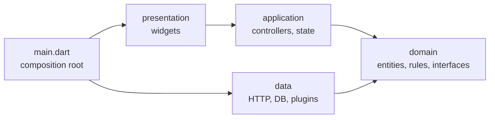

# 03 · App Architecture: Layers & Dependency Injection

Small apps survive any structure. Apps that live for years, with several developers, need two things: a way to find code
("where does checkout live?") and boundaries that keep changes local ("swapping the payment API shouldn't touch widgets").
There is no single official Flutter architecture, but the ideas that keep showing up — in Flutter's own architecture
guidance, in Bloc's and Riverpod's docs, in large open-source apps — are consistent. This lesson builds a checkout feature
with those ideas and adds a test that *enforces* them.

## Feature-first, then layers

```text
lib/arch/
  main.dart                         composition root
  features/
    checkout/
      domain/order.dart             entities, rules, interfaces the domain needs
      data/http_gateways.dart       implementations that do I/O
      application/checkout_controller.dart   use cases + state
      presentation/checkout_page.dart        widgets
    catalog/ ...
    account/ ...
  shared/ ...                       truly cross-cutting code (design system, logging)
```

Grouping by **feature** first means a change to checkout touches one folder. Inside each feature, **layers** separate
concerns, with dependencies pointing *inward*:



The **domain** depends on nothing. The **data** layer implements interfaces the domain declares (dependency inversion) —
the domain says "I need an `OrderGateway`", not "I call this REST endpoint". The **composition root** is the only code that
knows both the interfaces and the concrete classes, and wires them together.

## The layers in code

```dart title="domain/order.dart"
/// Domain: plain Dart. No Flutter, no HTTP, no JSON.
class LineItem {
  const LineItem(this.sku, this.unitCents, this.qty);
  final String sku;
  final int unitCents;
  final int qty;
}

class Order {
  const Order(this.items, {this.couponPercent = 0});
  final List<LineItem> items;
  final int couponPercent;

  int get subtotalCents => items.fold(0, (s, i) => s + i.unitCents * i.qty);
  int get discountCents => (subtotalCents * couponPercent / 100).round();
  int get totalCents => subtotalCents - discountCents;
}

/// What the domain needs from the outside world, expressed as interfaces it owns.
abstract interface class OrderGateway {
  Future<String> submit(Order order); // returns a confirmation id
}

abstract interface class CouponGateway {
  Future<int?> percentFor(String code); // null = invalid
}
```

```dart title="data/http_gateways.dart"
import 'dart:convert';
import 'package:http/http.dart' as http;
import '../domain/order.dart';

/// Data layer: implements domain interfaces with real I/O.
class HttpOrderGateway implements OrderGateway {
  HttpOrderGateway(this._client, this._base);
  final http.Client _client;
  final Uri _base;

  @override
  Future<String> submit(Order order) async {
    final res = await _client.post(
      _base.resolve('orders'),
      headers: {'Content-Type': 'application/json'},
      body: jsonEncode({
        'items': [for (final i in order.items) {'sku': i.sku, 'qty': i.qty}],
        'couponPercent': order.couponPercent,
      }),
    );
    if (res.statusCode != 201) throw StateError('Order failed: ${res.statusCode}');
    return (jsonDecode(res.body) as Map<String, dynamic>)['id'] as String;
  }
}

class HttpCouponGateway implements CouponGateway {
  HttpCouponGateway(this._client, this._base);
  final http.Client _client;
  final Uri _base;
  @override
  Future<int?> percentFor(String code) async {
    final res = await _client.get(_base.resolve('coupons/${Uri.encodeComponent(code)}'));
    if (res.statusCode == 404) return null;
    return (jsonDecode(res.body) as Map<String, dynamic>)['percent'] as int;
  }
}
```

```dart title="application/checkout_controller.dart"
import 'package:flutter_riverpod/flutter_riverpod.dart';
import '../domain/order.dart';

/// Application layer: orchestrates domain + gateways for one use case. Knows nothing about widgets.
final orderGatewayProvider = Provider<OrderGateway>((ref) => throw UnimplementedError('provided by the composition root'));
final couponGatewayProvider = Provider<CouponGateway>((ref) => throw UnimplementedError('provided by the composition root'));

sealed class CheckoutState {
  const CheckoutState(this.order);
  final Order order;
}

class Editing extends CheckoutState {
  const Editing(super.order, {this.couponError});
  final String? couponError;
}

class Submitting extends CheckoutState {
  const Submitting(super.order);
}

class Confirmed extends CheckoutState {
  const Confirmed(super.order, this.confirmationId);
  final String confirmationId;
}

class CheckoutController extends Notifier<CheckoutState> {
  @override
  CheckoutState build() => const Editing(Order([LineItem('mug', 1200, 2), LineItem('tee', 2500, 1)]));

  Future<void> applyCoupon(String code) async {
    final percent = await ref.read(couponGatewayProvider).percentFor(code.trim().toUpperCase());
    final items = state.order.items;
    state = percent == null
        ? Editing(Order(items), couponError: 'Unknown coupon')
        : Editing(Order(items, couponPercent: percent));
  }

  Future<void> submit() async {
    final order = state.order;
    state = Submitting(order);
    final id = await ref.read(orderGatewayProvider).submit(order);
    state = Confirmed(order, id);
  }
}

final checkoutProvider = NotifierProvider<CheckoutController, CheckoutState>(CheckoutController.new);
```

```dart title="presentation/checkout_page.dart"
import 'package:flutter/material.dart';
import 'package:flutter_riverpod/flutter_riverpod.dart';
import '../application/checkout_controller.dart';

/// Presentation: renders state, forwards intents. No business rules, no I/O.
class CheckoutPage extends ConsumerWidget {
  const CheckoutPage({super.key});
  @override
  Widget build(BuildContext context, WidgetRef ref) {
    final s = ref.watch(checkoutProvider);
    final c = ref.read(checkoutProvider.notifier);
    String money(int cents) => '\$${(cents / 100).toStringAsFixed(2)}';
    return Scaffold(
      appBar: AppBar(title: const Text('Checkout')),
      body: switch (s) {
        Confirmed(:final confirmationId) => Center(child: Text('Order $confirmationId confirmed')),
        Submitting() => const Center(child: CircularProgressIndicator()),
        Editing(:final order, :final couponError) => ListView(padding: const EdgeInsets.all(16), children: [
            Text('Subtotal ${money(order.subtotalCents)}'),
            if (order.discountCents > 0) Text('Discount -${money(order.discountCents)}'),
            Text('Total ${money(order.totalCents)}', key: const Key('total')),
            TextField(key: const Key('coupon'), decoration: InputDecoration(labelText: 'Coupon', errorText: couponError), onSubmitted: c.applyCoupon),
            FilledButton(onPressed: c.submit, child: const Text('Place order')),
          ]),
      },
    );
  }
}
```

```dart title="main.dart — the composition root"
import 'package:flutter/material.dart';
import 'package:flutter_riverpod/flutter_riverpod.dart';
import 'package:http/http.dart' as http;
import 'features/checkout/application/checkout_controller.dart';
import 'features/checkout/data/http_gateways.dart';
import 'features/checkout/presentation/checkout_page.dart';

/// Composition root: the ONE place that knows which implementations are used.
void main() {
  final client = http.Client();
  final api = Uri.parse(const String.fromEnvironment('API_URL', defaultValue: 'https://api.example.com/'));
  runApp(ProviderScope(
    overrides: [
      orderGatewayProvider.overrideWithValue(HttpOrderGateway(client, api)),
      couponGatewayProvider.overrideWithValue(HttpCouponGateway(client, api)),
    ],
    child: const MaterialApp(home: CheckoutPage()),
  ));
}
```

## Dependency injection, plainly

"Dependency injection" just means **objects receive their collaborators instead of creating them**. `HttpOrderGateway`
receives an `http.Client`; `CheckoutController` receives gateways through providers that `main` overrides. You can do DI
with:

- **Constructor parameters** — the simplest, and enough for many apps. Pass things down from `main`.
- **Riverpod providers + overrides** (used here) — the provider graph *is* the dependency graph, and tests override any node.
- **`provider`'s `Provider`/`ProxyProvider`** — the same idea via the widget tree.
- **Service locators** such as `get_it` (`getIt<OrderGateway>()`) — popular, simple; dependencies become implicit, so keep
  registrations in the composition root and reset them in tests.

Whichever you pick, the rule is the same: **only the composition root chooses implementations**.

## Testing each layer — and the architecture itself

```dart title="test/checkout_test.dart"
import 'package:flutter/material.dart';
import 'package:flutter_riverpod/flutter_riverpod.dart';
import 'package:flutter_test/flutter_test.dart';
import 'package:http/http.dart' as http;
import 'package:http/testing.dart';
import 'package:l2/arch/features/checkout/application/checkout_controller.dart';
import 'package:l2/arch/features/checkout/data/http_gateways.dart';
import 'package:l2/arch/features/checkout/domain/order.dart';
import 'package:l2/arch/features/checkout/presentation/checkout_page.dart';

class FakeOrders implements OrderGateway {
  Order? last;
  @override
  Future<String> submit(Order order) async {
    last = order;
    return 'A-1001';
  }
}

class FakeCoupons implements CouponGateway {
  @override
  Future<int?> percentFor(String code) async => code == 'SAVE10' ? 10 : null;
}

void main() {
  test('domain: totals are pure arithmetic', () {
    const o = Order([LineItem('mug', 1200, 2), LineItem('tee', 2500, 1)], couponPercent: 10);
    print('subtotal=${o.subtotalCents} discount=${o.discountCents} total=${o.totalCents}');
  });

  test('application: use case with fakes, no widgets', () async {
    final orders = FakeOrders();
    final c = ProviderContainer.test(overrides: [
      orderGatewayProvider.overrideWithValue(orders),
      couponGatewayProvider.overrideWithValue(FakeCoupons()),
    ]);
    final ctl = c.read(checkoutProvider.notifier);
    await ctl.applyCoupon('nope');
    print('bad coupon -> ${(c.read(checkoutProvider) as Editing).couponError}');
    await ctl.applyCoupon(' save10 ');
    await ctl.submit();
    print('submitted total=${orders.last!.totalCents}, state=${c.read(checkoutProvider).runtimeType}');
  });

  test('data: the HTTP gateway against a MockClient', () async {
    final gw = HttpOrderGateway(MockClient((req) async {
      print('${req.method} ${req.url} ${req.body}');
      return http.Response('{"id":"A-2002"}', 201);
    }), Uri.parse('https://api.example.com/'));
    print('id: ${await gw.submit(const Order([LineItem('mug', 1200, 1)]))}');
  });

  testWidgets('presentation: page with fake gateways', (tester) async {
    await tester.pumpWidget(ProviderScope(
      overrides: [
        orderGatewayProvider.overrideWithValue(FakeOrders()),
        couponGatewayProvider.overrideWithValue(FakeCoupons()),
      ],
      child: const MaterialApp(home: CheckoutPage()),
    ));
    await tester.enterText(find.byKey(const Key('coupon')), 'SAVE10');
    await tester.testTextInput.receiveAction(TextInputAction.done);
    await tester.pump();
    print(tester.widget<Text>(find.byKey(const Key('total'))).data);
    await tester.tap(find.text('Place order'));
    await tester.pump();
    print(find.text('Order A-1001 confirmed').evaluate().length == 1 ? 'confirmation shown' : 'missing');
  });
}
```

```dart title="test/architecture_test.dart"
import 'dart:io';
import 'package:flutter_test/flutter_test.dart';

/// Fails the build if a layer imports something it must not depend on.
void main() {
  const feature = 'lib/arch/features/checkout';
  final rules = {
    'domain': ['package:flutter', 'package:http', 'package:flutter_riverpod', '/data/', '/application/', '/presentation/'],
    'application': ['package:http', 'package:flutter/material.dart', '/data/', '/presentation/'],
    'presentation': ['package:http', '/data/'],
  };

  rules.forEach((layer, forbidden) {
    test('$layer has no forbidden imports', () {
      final violations = <String>[];
      for (final f in Directory('$feature/$layer').listSync(recursive: true).whereType<File>()) {
        for (final line in f.readAsLinesSync().where((l) => l.startsWith('import '))) {
          for (final bad in forbidden) {
            if (line.contains(bad)) violations.add('${f.path}: $line');
          }
        }
      }
      print('$layer: ${violations.isEmpty ? 'clean' : violations}');
      expect(violations, isEmpty);
    });
  });
}
```

```console
$ flutter test test/arch/
domain: clean
application: clean
presentation: clean
subtotal=4900 discount=490 total=4410
bad coupon -> Unknown coupon
submitted total=4410, state=Confirmed
POST https://api.example.com/orders {"items":[{"sku":"mug","qty":1}],"couponPercent":0}
id: A-2002
Total $44.10
confirmation shown
00:00 +7: All tests passed!
```

Each layer was tested at its own boundary: the domain with no dependencies at all, the use case with fakes and no widgets,
the data layer against a `MockClient`, and the page with fake gateways. None needed a network.

To see the architecture test earn its place, I added one line to the top of `domain/order.dart` —
`import 'package:flutter/material.dart' show Colors;` — the kind of "just need a colour here" shortcut that slowly couples a
domain to UI code:

```console
$ flutter test test/arch/architecture_test.dart
domain: [lib/arch/features/checkout/domain/order.dart: import 'package:flutter/material.dart' show Colors;]
  Expected: empty
    Actual: [
00:00 +2 -1: Some tests failed.
```

A twenty-line test turns an architecture diagram into a rule CI enforces. (Packages and custom lint rules can do the same
more thoroughly; the principle is what matters.)

## How much architecture?

Layers cost files and indirection. A reasonable progression:

- **Prototype / small app**: feature folders; widgets + a state class + a repository. Skip separate domain models if the API
  models are fine.
- **Growing app**: introduce interfaces where you need to swap or fake things (network, storage, platform), a composition
  root, and tests per layer.
- **Large app / many teams**: per-feature packages in a monorepo (each with its own `pubspec.yaml`), enforced boundaries,
  shared design-system package.

Add structure when a concrete pain appears — slow tests, merge conflicts, a feature that's hard to change — not in advance.

## How It Actually Works

At runtime, "architecture" is just which objects hold references to which. In this app, `main` constructs one `http.Client`
and two gateways, and places them in the root `ProviderContainer` as overrides. When `CheckoutPage` first watches
`checkoutProvider`, Riverpod creates the controller; when the controller calls `ref.read(orderGatewayProvider)`, the
container returns the override instead of running the throwing default. Nothing below `main` ever names `HttpOrderGateway`,
which is why a test can construct a different container with `FakeOrders` and exercise every line above the data layer. The
architecture test works at a different level — on source text before compilation — so it catches dependency mistakes even
when they compile and run fine.

## Common mistakes

- **Layer-first top level** (`lib/models`, `lib/screens`, `lib/services`) in big apps: every feature is spread across the
  whole tree.
- **Domain classes that import Flutter or JSON** — the domain becomes untestable without the framework.
- **Constructing dependencies deep inside widgets** (`final api = HttpOrderGateway(http.Client(), ...)` in `build`).
- **Interfaces for everything** "just in case" — interfaces where there's one implementation and no test seam are noise.
- **Service locator calls scattered everywhere**, making dependencies invisible. If you use one, inject at the edges.

## Exercise

1. Add a `catalog` feature with the same four layers. Extend the architecture test so features can't import each other's
   `data` or `presentation` folders.
2. Replace Riverpod overrides with plain constructor injection for `CheckoutController` (pass gateways in). What changes in
   the tests?
3. Add a `FakeOrderGateway` that the app uses when started with `--dart-define=FAKE_API=true` — useful for demos and
   screenshots ([lesson 04](04-flavors-config.md)).
4. Move `checkout` into its own Dart package under `packages/checkout`, and depend on it from the app with a path dependency.
