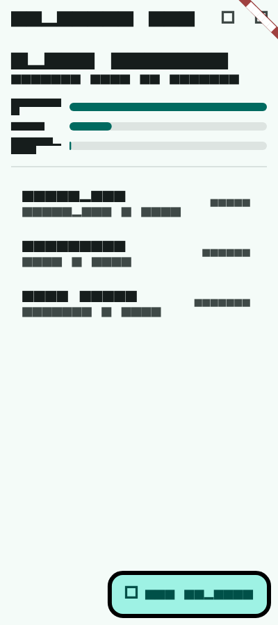

# 10 · Capstone — A Production-Ready Expense Tracker

The capstone pulls the whole course into one app you could actually ship: a monthly expense tracker with a budget, a category
chart, add/edit/delete with undo, durable local storage, and a test suite that covers every layer. Nothing here is new — the
point is seeing the pieces fit, and the decisions that make an app maintainable rather than merely working.

**Features**: month view with total, remaining budget (or over-budget warning) and a per-category bar chart; add and edit
expenses with validation; swipe to delete with *Undo*; previous/next month navigation; deep links that survive deleted data;
persistence across launches.

```text
lib/cap/
  domain/expense.dart                 Expense, Month, MonthSummary   pure Dart        (Level 2 · 10, Level 4 · 03)
  data/expense_repository.dart        JSON file + in-memory stores   I/O boundary     (Level 2 · 08)
  application/expenses.dart           Riverpod controllers            app logic        (Level 2 · 05)
  presentation/format.dart            money formatting, input parsing                  (Level 3 · 08)
  presentation/category_chart.dart    CustomPaint chart + semantics                    (Level 3 · 03)
  presentation/pages.dart             go_router + pages                                (Level 2 · 02)
  main.dart                           composition root                                 (Level 4 · 03)
test/cap/  domain, repository, app (widget + a11y + golden), architecture
```

Packages: `flutter_riverpod` 3.4.3, `go_router` 18.0.2, `intl` 0.20.2, `path_provider` 2.1.6, on Flutter 3.44.8. This code is
formatted with `dart format --line-length 120` (a project choice for readability on wide screens; pick one width and enforce it in
CI). `flutter analyze` reports no issues for `lib/cap`.

## Domain

```dart title="lib/cap/domain/expense.dart"
/// Domain model for the expense tracker. Pure Dart: no Flutter, no I/O.
enum Category { food, transport, housing, fun, health, other }

class Expense {
  Expense({required this.id, required this.amountCents, required this.category, required this.date, this.note = ''}) {
    if (amountCents <= 0) {
      throw ArgumentError.value(amountCents, 'amountCents', 'must be > 0');
    }
  }

  final String id;
  final int amountCents; // integer minor units: never double for money
  final Category category;
  final DateTime date; // calendar date; time part is ignored
  final String note;

  Expense copyWith({int? amountCents, Category? category, DateTime? date, String? note}) => Expense(
    id: id,
    amountCents: amountCents ?? this.amountCents,
    category: category ?? this.category,
    date: date ?? this.date,
    note: note ?? this.note,
  );

  Map<String, Object?> toJson() => {
    'id': id,
    'amountCents': amountCents,
    'category': category.name,
    'date': '${date.year}-${_two(date.month)}-${_two(date.day)}',
    'note': note,
  };

  factory Expense.fromJson(Map<String, Object?> j) => switch (j) {
    {
      'id': String id,
      'amountCents': int amount,
      'category': String category,
      'date': String date,
      'note': String note,
    } =>
      Expense(
        id: id,
        amountCents: amount,
        category: Category.values.byName(category),
        date: DateTime.parse(date),
        note: note,
      ),
    _ => throw FormatException('Invalid expense: $j'),
  };

  static String _two(int n) => n.toString().padLeft(2, '0');
}

/// A calendar month, used as the unit for budgets and summaries.
class Month {
  const Month(this.year, this.month);
  factory Month.of(DateTime d) => Month(d.year, d.month);
  final int year;
  final int month;

  Month get previous => month == 1 ? Month(year - 1, 12) : Month(year, month - 1);
  Month get next => month == 12 ? Month(year + 1, 1) : Month(year, month + 1);
  bool contains(DateTime d) => d.year == year && d.month == month;

  @override
  bool operator ==(Object other) => other is Month && other.year == year && other.month == month;
  @override
  int get hashCode => Object.hash(year, month);
  @override
  String toString() => '$year-${month.toString().padLeft(2, '0')}';
}

class MonthSummary {
  MonthSummary(this.month, Iterable<Expense> all, {required this.budgetCents})
    : expenses = all.where((e) => month.contains(e.date)).toList()..sort((a, b) => b.date.compareTo(a.date));

  final Month month;
  final List<Expense> expenses; // newest first
  final int budgetCents;

  int get totalCents => expenses.fold(0, (s, e) => s + e.amountCents);
  int get remainingCents => budgetCents - totalCents;
  bool get overBudget => totalCents > budgetCents;

  /// Totals per category, largest first, omitting empty categories.
  List<(Category, int)> get byCategory {
    final totals = <Category, int>{};
    for (final e in expenses) {
      totals.update(e.category, (v) => v + e.amountCents, ifAbsent: () => e.amountCents);
    }
    return totals.entries.map((e) => (e.key, e.value)).toList()..sort((a, b) => b.$2.compareTo(a.$2));
  }
}
```

Decisions: money in **integer cents** with the invariant (`> 0`) enforced in the constructor; validation at the JSON boundary with a
pattern; `Month` as a value type with `==`/`hashCode` so it can be compared and used as a key; `MonthSummary` computes everything
derived — nothing derived is ever stored.

## Data

```dart title="lib/cap/data/expense_repository.dart"
import 'dart:convert';
import 'dart:io';

import '../domain/expense.dart';

abstract interface class ExpenseRepository {
  Future<List<Expense>> loadAll();
  Future<void> saveAll(List<Expense> expenses);
}

/// Stores everything in one versioned JSON file, written atomically.
class JsonFileExpenseRepository implements ExpenseRepository {
  JsonFileExpenseRepository(this.file);
  final File file;
  static const version = 1;

  @override
  Future<List<Expense>> loadAll() async {
    if (!await file.exists()) return [];
    final data = jsonDecode(await file.readAsString());
    if (data is! Map<String, Object?> || data['version'] != version) {
      throw FormatException('Unsupported expenses file (version ${data is Map ? data['version'] : '?'})');
    }
    return [for (final e in data['expenses'] as List) Expense.fromJson(e as Map<String, Object?>)];
  }

  @override
  Future<void> saveAll(List<Expense> expenses) async {
    final tmp = File('${file.path}.tmp');
    await tmp.writeAsString(
      jsonEncode({
        'version': version,
        'expenses': [for (final e in expenses) e.toJson()],
      }),
      flush: true,
    );
    await tmp.rename(file.path);
  }
}

class InMemoryExpenseRepository implements ExpenseRepository {
  InMemoryExpenseRepository([List<Expense> seed = const []]) : _items = [...seed];
  List<Expense> _items;
  int saves = 0;

  @override
  Future<List<Expense>> loadAll() async => [..._items];

  @override
  Future<void> saveAll(List<Expense> expenses) async {
    saves++;
    _items = [...expenses];
  }
}
```

A versioned file written atomically, and a version guard that refuses files from the future rather than misreading them.

## Application

```dart title="lib/cap/application/expenses.dart"
import 'package:flutter_riverpod/flutter_riverpod.dart';

import '../data/expense_repository.dart';
import '../domain/expense.dart';

final expenseRepositoryProvider = Provider<ExpenseRepository>(
  (ref) => throw UnimplementedError('provided by the composition root'),
);
final clockProvider = Provider<DateTime Function()>((ref) => DateTime.now);
final budgetProvider = Provider<int>((ref) => 50000); // cents; would come from settings

class ExpensesController extends AsyncNotifier<List<Expense>> {
  @override
  Future<List<Expense>> build() => ref.watch(expenseRepositoryProvider).loadAll();

  Future<void> _set(List<Expense> next) async {
    final previous = state.value ?? const <Expense>[];
    state = AsyncData(next);
    try {
      await ref.read(expenseRepositoryProvider).saveAll(next);
    } catch (e, st) {
      state = AsyncData(previous); // roll back the optimistic update
      Error.throwWithStackTrace(e, st);
    }
  }

  Future<void> upsert(Expense e) {
    final all = state.requireValue;
    final exists = all.any((x) => x.id == e.id);
    return _set(exists ? [for (final x in all) x.id == e.id ? e : x] : [...all, e]);
  }

  Future<Expense> remove(String id) async {
    final removed = state.requireValue.firstWhere((x) => x.id == id);
    await _set(state.requireValue.where((x) => x.id != id).toList());
    return removed; // returned so the UI can offer "Undo"
  }

  String newId() => ref.read(clockProvider)().microsecondsSinceEpoch.toRadixString(36);
}

final expensesProvider = AsyncNotifierProvider<ExpensesController, List<Expense>>(ExpensesController.new);

class SelectedMonth extends Notifier<Month> {
  @override
  Month build() => Month.of(ref.read(clockProvider)());
  void previous() => state = state.previous;
  void next() => state = state.next;
}

final selectedMonthProvider = NotifierProvider<SelectedMonth, Month>(SelectedMonth.new);

final summaryProvider = Provider<AsyncValue<MonthSummary>>((ref) {
  final month = ref.watch(selectedMonthProvider);
  final budget = ref.watch(budgetProvider);
  return ref.watch(expensesProvider).whenData((all) => MonthSummary(month, all, budgetCents: budget));
});
```

- **Optimistic updates with rollback**: the UI changes immediately; if saving fails, the previous state is restored and the error
  rethrown for the caller to report.
- **`remove` returns the removed expense**, which is all the UI needs to implement *Undo* via `upsert`.
- **The clock is injected** (`clockProvider`), so "today" and the default month are deterministic in tests.

## Presentation

```dart title="lib/cap/presentation/format.dart"
import 'package:intl/intl.dart';

import '../domain/expense.dart';

String money(int cents, {String locale = 'en_US', String currency = 'USD'}) =>
    NumberFormat.simpleCurrency(locale: locale, name: currency).format(cents / 100);

const categoryLabels = {
  Category.food: 'Food',
  Category.transport: 'Transport',
  Category.housing: 'Housing',
  Category.fun: 'Fun',
  Category.health: 'Health',
  Category.other: 'Other',
};

/// Parses user input like "12", "12.5" or "12.50" into cents; null if invalid.
int? parseCents(String input) {
  final m = RegExp(r'^\s*(\d{1,7})(?:[.,](\d{1,2}))?\s*$').firstMatch(input);
  if (m == null) return null;
  final whole = int.parse(m.group(1)!);
  final frac = (m.group(2) ?? '').padRight(2, '0');
  return whole * 100 + int.parse(frac);
}
```

```dart title="lib/cap/presentation/category_chart.dart"
import 'package:flutter/material.dart';

import '../domain/expense.dart';
import 'format.dart';

/// Horizontal bars per category, drawn with CustomPaint and described for screen readers.
class CategoryChart extends StatelessWidget {
  const CategoryChart({super.key, required this.data});
  final List<(Category, int)> data;

  @override
  Widget build(BuildContext context) {
    final scheme = Theme.of(context).colorScheme;
    final description = data.map((d) => '${categoryLabels[d.$1]} ${money(d.$2)}').join(', ');
    return Semantics(
      label: data.isEmpty ? 'No spending this month' : 'Spending by category: $description',
      child: ExcludeSemantics(
        child: RepaintBoundary(
          child: SizedBox(
            height: 28.0 * data.length,
            child: CustomPaint(
              painter: _BarsPainter(
                data,
                bar: scheme.primary,
                track: scheme.surfaceContainerHighest,
                text: scheme.onSurface,
              ),
            ),
          ),
        ),
      ),
    );
  }
}

class _BarsPainter extends CustomPainter {
  _BarsPainter(this.data, {required this.bar, required this.track, required this.text});
  final List<(Category, int)> data;
  final Color bar, track, text;

  @override
  void paint(Canvas canvas, Size size) {
    if (data.isEmpty) return;
    final max = data.first.$2; // data is sorted largest first
    const labelWidth = 84.0, rowHeight = 28.0, barHeight = 12.0;
    for (var i = 0; i < data.length; i++) {
      final (category, cents) = data[i];
      final y = i * rowHeight;
      final label = TextPainter(
        text: TextSpan(
          text: categoryLabels[category],
          style: TextStyle(color: text, fontSize: 12),
        ),
        textDirection: TextDirection.ltr,
      )..layout(maxWidth: labelWidth - 8);
      label.paint(canvas, Offset(0, y + (rowHeight - label.height) / 2));
      final trackRect = Rect.fromLTWH(labelWidth, y + (rowHeight - barHeight) / 2, size.width - labelWidth, barHeight);
      final radius = const Radius.circular(barHeight / 2);
      canvas.drawRRect(RRect.fromRectAndRadius(trackRect, radius), Paint()..color = track);
      final filled = Rect.fromLTWH(trackRect.left, trackRect.top, trackRect.width * cents / max, barHeight);
      canvas.drawRRect(RRect.fromRectAndRadius(filled, radius), Paint()..color = bar);
    }
  }

  @override
  bool shouldRepaint(_BarsPainter old) =>
      old.bar != bar || old.track != track || old.text != text || !_sameData(old.data, data);

  static bool _sameData(List<(Category, int)> a, List<(Category, int)> b) {
    if (a.length != b.length) return false;
    for (var i = 0; i < a.length; i++) {
      if (a[i] != b[i]) return false;
    }
    return true;
  }
}
```

```dart title="lib/cap/presentation/pages.dart"
import 'package:flutter/material.dart';
import 'package:flutter_riverpod/flutter_riverpod.dart';
import 'package:go_router/go_router.dart';

import '../application/expenses.dart';
import '../domain/expense.dart';
import 'category_chart.dart';
import 'format.dart';

GoRouter buildRouter() => GoRouter(
  routes: [
    GoRoute(
      path: '/',
      builder: (_, _) => const MonthPage(),
      routes: [
        GoRoute(path: 'new', builder: (_, _) => const EditExpensePage()),
        GoRoute(
          path: 'edit/:id',
          builder: (_, s) => EditExpensePage(id: s.pathParameters['id']),
        ),
      ],
    ),
  ],
);

class MonthPage extends ConsumerWidget {
  const MonthPage({super.key});

  @override
  Widget build(BuildContext context, WidgetRef ref) {
    final summary = ref.watch(summaryProvider);
    final month = ref.watch(selectedMonthProvider);
    final nav = ref.read(selectedMonthProvider.notifier);
    return Scaffold(
      appBar: AppBar(
        title: Text('Expenses $month'),
        actions: [
          IconButton(tooltip: 'Previous month', icon: const Icon(Icons.chevron_left), onPressed: nav.previous),
          IconButton(tooltip: 'Next month', icon: const Icon(Icons.chevron_right), onPressed: nav.next),
        ],
      ),
      floatingActionButton: FloatingActionButton.extended(
        onPressed: () => context.go('/new'),
        icon: const Icon(Icons.add),
        label: const Text('Add expense'),
      ),
      body: switch (summary) {
        AsyncError(:final error) => Center(child: Text('Could not load expenses: $error')),
        AsyncData(value: final s) => _MonthBody(summary: s),
        _ => const Center(child: CircularProgressIndicator()),
      },
    );
  }
}

class _MonthBody extends ConsumerWidget {
  const _MonthBody({required this.summary});
  final MonthSummary summary;

  @override
  Widget build(BuildContext context, WidgetRef ref) {
    final theme = Theme.of(context);
    return ListView(
      padding: const EdgeInsets.fromLTRB(16, 16, 16, 96),
      children: [
        Text('Spent ${money(summary.totalCents)}', key: const Key('total'), style: theme.textTheme.headlineSmall),
        Text(
          summary.overBudget
              ? 'Over budget by ${money(-summary.remainingCents)}'
              : '${money(summary.remainingCents)} left of ${money(summary.budgetCents)}',
          key: const Key('budget'),
          style: TextStyle(color: summary.overBudget ? theme.colorScheme.error : null),
        ),
        const SizedBox(height: 16),
        CategoryChart(data: summary.byCategory),
        const Divider(height: 32),
        if (summary.expenses.isEmpty) const Text('No expenses this month'),
        for (final e in summary.expenses)
          Dismissible(
            key: ValueKey(e.id),
            direction: DismissDirection.endToStart,
            background: Container(
              alignment: Alignment.centerRight,
              color: theme.colorScheme.errorContainer,
              child: const Icon(Icons.delete),
            ),
            onDismissed: (_) async {
              final messenger = ScaffoldMessenger.of(context);
              final removed = await ref.read(expensesProvider.notifier).remove(e.id);
              messenger.showSnackBar(
                SnackBar(
                  content: Text('Deleted ${money(removed.amountCents)}'),
                  action: SnackBarAction(
                    label: 'Undo',
                    onPressed: () => ref.read(expensesProvider.notifier).upsert(removed),
                  ),
                ),
              );
            },
            child: ListTile(
              title: Text(e.note.isEmpty ? categoryLabels[e.category]! : e.note),
              subtitle: Text('${categoryLabels[e.category]} · ${e.date.day}/${e.date.month}'),
              trailing: Text(money(e.amountCents)),
              onTap: () => context.go('/edit/${e.id}'),
            ),
          ),
      ],
    );
  }
}

class EditExpensePage extends ConsumerStatefulWidget {
  const EditExpensePage({super.key, this.id});
  final String? id;

  @override
  ConsumerState<EditExpensePage> createState() => _EditExpensePageState();
}

class _EditExpensePageState extends ConsumerState<EditExpensePage> {
  final _form = GlobalKey<FormState>();
  final _amount = TextEditingController();
  final _note = TextEditingController();
  Category _category = Category.food;
  late DateTime _date = ref.read(clockProvider)();
  Expense? _original;

  @override
  void initState() {
    super.initState();
    final id = widget.id;
    if (id != null) {
      _original = ref.read(expensesProvider).value?.where((e) => e.id == id).firstOrNull;
      if (_original case final e?) {
        _amount.text = (e.amountCents / 100).toStringAsFixed(2);
        _note.text = e.note;
        _category = e.category;
        _date = e.date;
      }
    }
  }

  @override
  void dispose() {
    _amount.dispose();
    _note.dispose();
    super.dispose();
  }

  Future<void> _save() async {
    if (!_form.currentState!.validate()) return;
    final ctl = ref.read(expensesProvider.notifier);
    final cents = parseCents(_amount.text)!;
    final expense =
        _original?.copyWith(amountCents: cents, category: _category, date: _date, note: _note.text.trim()) ??
        Expense(id: ctl.newId(), amountCents: cents, category: _category, date: _date, note: _note.text.trim());
    await ctl.upsert(expense);
    if (mounted) context.go('/');
  }

  @override
  Widget build(BuildContext context) {
    if (widget.id != null && _original == null) {
      return Scaffold(
        appBar: AppBar(),
        body: const Center(child: Text('This expense no longer exists')),
      );
    }
    return Scaffold(
      appBar: AppBar(title: Text(_original == null ? 'New expense' : 'Edit expense')),
      body: Form(
        key: _form,
        child: ListView(
          padding: const EdgeInsets.all(16),
          children: [
            TextFormField(
              key: const Key('amount'),
              controller: _amount,
              keyboardType: const TextInputType.numberWithOptions(decimal: true),
              decoration: const InputDecoration(labelText: 'Amount', prefixText: r'$ '),
              validator: (v) => switch (parseCents(v ?? '')) {
                null => 'Enter an amount like 12.50',
                0 => 'Amount must be more than zero',
                _ => null,
              },
            ),
            const SizedBox(height: 12),
            DropdownButtonFormField<Category>(
              key: const Key('category'),
              initialValue: _category,
              decoration: const InputDecoration(labelText: 'Category'),
              items: [for (final c in Category.values) DropdownMenuItem(value: c, child: Text(categoryLabels[c]!))],
              onChanged: (c) => setState(() => _category = c!),
            ),
            const SizedBox(height: 12),
            TextFormField(
              key: const Key('note'),
              controller: _note,
              decoration: const InputDecoration(labelText: 'Note (optional)'),
            ),
            const SizedBox(height: 24),
            FilledButton(onPressed: _save, child: const Text('Save')),
          ],
        ),
      ),
    );
  }
}
```

Notes:

- `MonthPage` renders `AsyncValue` states exhaustively; `_MonthBody` only ever sees loaded data.
- The `ScaffoldMessenger` is captured *before* the `await` in `onDismissed`, so the snackbar works even though the dismissed row is
  gone by then (the `BuildContext`-after-`await` rule from [Level 2 · 01](../level-2/01-navigator.md)).
- The chart is a `RepaintBoundary` with its own semantics label and its painted text excluded, so screen readers hear one sentence.
- The edit page handles an id that no longer exists — reachable via a stale deep link or a deleted item.

## Composition root

```dart title="lib/cap/main.dart"
import 'dart:io';

import 'package:flutter/material.dart';
import 'package:flutter_riverpod/flutter_riverpod.dart';
import 'package:path_provider/path_provider.dart';

import 'application/expenses.dart';
import 'data/expense_repository.dart';
import 'presentation/pages.dart';

/// Composition root.
Future<void> main() async {
  WidgetsFlutterBinding.ensureInitialized();
  final dir = await getApplicationDocumentsDirectory();
  runApp(
    ProviderScope(
      overrides: [
        expenseRepositoryProvider.overrideWithValue(JsonFileExpenseRepository(File('${dir.path}/expenses.json'))),
      ],
      child: const ExpenseApp(),
    ),
  );
}

class ExpenseApp extends StatefulWidget {
  const ExpenseApp({super.key});
  @override
  State<ExpenseApp> createState() => _ExpenseAppState();
}

class _ExpenseAppState extends State<ExpenseApp> {
  final _router = buildRouter();

  @override
  void dispose() {
    _router.dispose();
    super.dispose();
  }

  @override
  Widget build(BuildContext context) => MaterialApp.router(
    title: 'Expenses',
    theme: ThemeData(colorSchemeSeed: Colors.teal),
    darkTheme: ThemeData(colorSchemeSeed: Colors.teal, brightness: Brightness.dark),
    routerConfig: _router,
  );
}
```

## Tests

```dart title="test/cap/domain_test.dart"
import 'package:flutter_test/flutter_test.dart';
import 'package:l2/cap/domain/expense.dart';
import 'package:l2/cap/presentation/format.dart';

Expense e(String id, int cents, Category c, String date) =>
    Expense(id: id, amountCents: cents, category: c, date: DateTime.parse(date));

void main() {
  test('month summary: filtering, totals, ordering, budget', () {
    final all = [
      e('1', 1250, Category.food, '2026-10-02'),
      e('2', 4000, Category.transport, '2026-10-05'),
      e('3', 899, Category.food, '2026-10-07'),
      e('4', 99999, Category.housing, '2026-09-30'), // previous month
    ];
    final s = MonthSummary(const Month(2026, 10), all, budgetCents: 5000);
    print('ids newest first: ${s.expenses.map((x) => x.id).toList()}');
    print('total=${s.totalCents} remaining=${s.remainingCents} over=${s.overBudget}');
    print('byCategory: ${s.byCategory.map((x) => '${x.$1.name}=${x.$2}').toList()}');
  });

  test('month arithmetic wraps years', () {
    print('${const Month(2026, 1).previous} ${const Month(2026, 12).next}');
  });

  test('invariants and parsing', () {
    expect(() => e('x', 0, Category.fun, '2026-10-01'), throwsArgumentError);
    final inputs = ['12', '12.5', '12.50', '0.07', '12,5', '12.505', 'abc', '-3', ''];
    print(inputs.map((i) => '"$i"->${parseCents(i)}').join('  '));
    print('JSON round trip: ${Expense.fromJson(e('a', 1999, Category.fun, '2026-10-09').toJson()).toJson()}');
    expect(() => Expense.fromJson({'id': 'a', 'amountCents': '1999'}), throwsFormatException);
  });

  test('money formatting', () {
    print('${money(123456)} | ${money(5)} | ${money(123456, locale: 'de_DE', currency: 'EUR')}');
  });
}
```

```dart title="test/cap/repository_test.dart"
import 'dart:io';
import 'package:flutter_test/flutter_test.dart';
import 'package:l2/cap/data/expense_repository.dart';
import 'package:l2/cap/domain/expense.dart';

void main() {
  test('JSON file repository: round trip and version guard', () async {
    final dir = await Directory.systemTemp.createTemp('exp');
    addTearDown(() => dir.delete(recursive: true));
    final repo = JsonFileExpenseRepository(File('${dir.path}/expenses.json'));
    print('empty: ${await repo.loadAll()}');
    await repo.saveAll([
      Expense(id: 'a', amountCents: 350, category: Category.food, date: DateTime(2026, 10, 9), note: 'coffee'),
    ]);
    print('file: ${await repo.file.readAsString()}');
    print('reloaded: ${(await repo.loadAll()).single.note}');
    await repo.file.writeAsString('{"version": 2, "expenses": []}');
    try {
      await repo.loadAll();
    } on FormatException catch (e) {
      print('guard: ${e.message}');
    }
  });
}
```

```dart title="test/cap/app_test.dart"
import 'package:flutter/material.dart';
import 'package:flutter_riverpod/flutter_riverpod.dart';
import 'package:flutter_test/flutter_test.dart';
import 'package:l2/cap/application/expenses.dart';
import 'package:l2/cap/data/expense_repository.dart';
import 'package:l2/cap/domain/expense.dart';
import 'package:go_router/go_router.dart';
import 'package:l2/cap/main.dart';
import 'package:l2/cap/presentation/category_chart.dart';
import 'package:l2/cap/presentation/pages.dart';

class FailingRepo extends InMemoryExpenseRepository {
  FailingRepo(super.seed);
  @override
  Future<void> saveAll(List<Expense> expenses) async => throw StateError('disk full');
}

final today = DateTime(2026, 10, 9, 14, 30);
final seed = [
  Expense(id: 'r', amountCents: 30000, category: Category.housing, date: DateTime(2026, 10, 1), note: 'Rent share'),
  Expense(id: 'g', amountCents: 6420, category: Category.food, date: DateTime(2026, 10, 6), note: 'Groceries'),
  Expense(id: 'b', amountCents: 250, category: Category.transport, date: DateTime(2026, 10, 8)),
  Expense(id: 's', amountCents: 1500, category: Category.fun, date: DateTime(2026, 9, 20), note: 'Cinema'),
];

Future<InMemoryExpenseRepository> pumpApp(WidgetTester tester, {InMemoryExpenseRepository? repo}) async {
  final r = repo ?? InMemoryExpenseRepository(seed);
  tester.view.physicalSize = const Size(400, 900);
  tester.view.devicePixelRatio = 1;
  addTearDown(tester.view.reset);
  await tester.pumpWidget(
    ProviderScope(
      overrides: [expenseRepositoryProvider.overrideWithValue(r), clockProvider.overrideWithValue(() => today)],
      child: const ExpenseApp(),
    ),
  );
  await tester.pumpAndSettle();
  return r;
}

String text(WidgetTester t, String key) => t.widget<Text>(find.byKey(Key(key))).data!;

void main() {
  testWidgets('month view, navigation between months', (tester) async {
    await pumpApp(tester);
    print(
      '${tester.widget<Text>(find.descendant(of: find.byType(AppBar), matching: find.byType(Text))).data}: '
      '${text(tester, 'total')} / ${text(tester, 'budget')}',
    );
    print('rows: ${tester.widgetList<ListTile>(find.byType(ListTile)).map((t) => (t.title as Text).data).toList()}');
    await tester.tap(find.byTooltip('Previous month'));
    await tester.pumpAndSettle();
    print('September: ${text(tester, 'total')}, rows ${find.byType(ListTile).evaluate().length}');
  });

  testWidgets('add with validation', (tester) async {
    final repo = await pumpApp(tester);
    await tester.tap(find.text('Add expense'));
    await tester.pumpAndSettle();
    await tester.enterText(find.byKey(const Key('amount')), '12.505');
    await tester.tap(find.text('Save'));
    await tester.pump();
    print('validation: ${find.text('Enter an amount like 12.50').evaluate().length}');
    await tester.enterText(find.byKey(const Key('amount')), '18.40');
    await tester.tap(find.byKey(const Key('category')));
    await tester.pumpAndSettle();
    await tester.tap(find.text('Fun').last);
    await tester.pumpAndSettle();
    await tester.enterText(find.byKey(const Key('note')), 'Board game cafe');
    await tester.tap(find.text('Save'));
    await tester.pumpAndSettle();
    print('after add: ${text(tester, 'total')} / ${text(tester, 'budget')}; saves=${repo.saves}');
  });

  testWidgets('edit, then swipe to delete and undo', (tester) async {
    final repo = await pumpApp(tester);
    await tester.tap(find.text('Groceries'));
    await tester.pumpAndSettle();
    print('edit form prefilled: ${tester.widget<TextFormField>(find.byKey(const Key('amount'))).controller!.text}');
    await tester.enterText(find.byKey(const Key('amount')), '80');
    await tester.tap(find.text('Save'));
    await tester.pumpAndSettle();
    print('after edit: ${text(tester, 'total')} / ${text(tester, 'budget')}');

    await tester.drag(find.text('Rent share'), const Offset(-500, 0));
    await tester.pumpAndSettle();
    print('after delete: ${text(tester, 'total')}; snackbar: ${find.text('Deleted \$300.00').evaluate().length}');
    await tester.tap(find.text('Undo'));
    await tester.pumpAndSettle();
    print(
      'after undo: ${text(tester, 'total')}; stored ${(await repo.loadAll()).length} expenses, saves=${repo.saves}',
    );
  });

  testWidgets('failed save rolls back the optimistic update', (tester) async {
    await pumpApp(tester, repo: FailingRepo(seed));
    final container = ProviderScope.containerOf(tester.element(find.byType(Scaffold).first));
    Object? error;
    await tester.runAsync(() async {
      try {
        await container.read(expensesProvider.notifier).remove('r');
      } catch (e) {
        error = e;
      }
    });
    await tester.pumpAndSettle();
    print('error: $error; total still ${text(tester, 'total')}');
  });

  testWidgets('deep link to a deleted expense', (tester) async {
    await pumpApp(tester);
    GoRouter.of(tester.element(find.byType(MonthPage))).go('/edit/nope');
    await tester.pumpAndSettle();
    print(
      find.text('This expense no longer exists').evaluate().isNotEmpty ? 'missing-expense page shown' : 'NOT shown',
    );
  });

  testWidgets('accessibility guidelines on the month page', (tester) async {
    final handle = tester.ensureSemantics();
    await pumpApp(tester);
    for (final (name, g) in [
      ('tap targets', androidTapTargetGuideline),
      ('labels', labeledTapTargetGuideline),
      ('contrast', textContrastGuideline),
    ]) {
      final r = await g.evaluate(tester);
      print('$name: ${r.passed ? 'pass' : 'FAIL ${r.reason}'}');
    }
    print('chart says: "${tester.getSemantics(find.byType(CategoryChart)).label}"');
    handle.dispose();
  });

  testWidgets('golden: month page', (tester) async {
    await pumpApp(tester);
    await expectLater(find.byType(MaterialApp), matchesGoldenFile('goldens/month_page.png'));
  });
}
```

```dart title="test/cap/architecture_test.dart"
import 'dart:io';
import 'package:flutter_test/flutter_test.dart';

void main() {
  const root = 'lib/cap';
  const forbidden = {
    'domain': ['package:flutter', 'package:flutter_riverpod', 'dart:io', '/data/', '/application/', '/presentation/'],
    'application': ['dart:io', 'package:flutter/material.dart', '/presentation/', 'expense_repository.dart"'],
    'presentation': ['dart:io', '/data/'],
  };
  forbidden.forEach((layer, rules) {
    test('$layer imports', () {
      final bad = [
        for (final f in Directory('$root/$layer').listSync(recursive: true).whereType<File>())
          for (final line in f.readAsLinesSync().where((l) => l.startsWith('import ')))
            if (rules.any(line.contains)) '${f.path}: $line',
      ];
      expect(bad, isEmpty);
    });
  });
}
```

```console
$ flutter test test/cap/
empty: []
file: {"version":1,"expenses":[{"id":"a","amountCents":350,"category":"food","date":"2026-10-09","note":"coffee"}]}
reloaded: coffee
guard: Unsupported expenses file (version 2)
ids newest first: [3, 2, 1]
total=6149 remaining=-1149 over=true
byCategory: [transport=4000, food=2149]
2025-12 2027-01
"12"->1200  "12.5"->1250  "12.50"->1250  "0.07"->7  "12,5"->1250  "12.505"->null  "abc"->null  "-3"->null  ""->null
JSON round trip: {id: a, amountCents: 1999, category: fun, date: 2026-10-09, note: }
$1,234.56 | $0.05 | 1.234,56 €
Expenses 2026-10: Spent $366.70 / $133.30 left of $500.00
rows: [Transport, Groceries, Rent share]
September: Spent $15.00, rows 1
validation: 1
after add: Spent $385.10 / $114.90 left of $500.00; saves=1
edit form prefilled: 64.20
after edit: Spent $382.50 / $117.50 left of $500.00
after delete: Spent $82.50; snackbar: 1
after undo: Spent $382.50; stored 4 expenses, saves=3
error: Bad state: disk full; total still Spent $366.70
missing-expense page shown
tap targets: pass
labels: pass
contrast: pass
chart says: "Spending by category: Housing $300.00, Food $64.20, Transport $2.50"
00:01 +15: All tests passed!
```

(Test files run in parallel, so the order of printed lines interleaves by file.) What each group proved:

- **Domain**: the September expense was excluded from October; totals, over-budget state and category ordering are right; months
  wrap across years; input parsing accepts `12,5` (comma decimal) but rejects three decimals, negatives and text; `intl` formats
  `$1,234.56` and `1.234,56 €` correctly per locale.
- **Repository**: the on-disk JSON is exactly what we intended and a future file version is refused.
- **App flows**: the month view's numbers match the seed (300.00 + 64.20 + 2.50 = 366.70); September shows only the cinema ticket;
  invalid input is rejected, a valid add updates the budget and saves once; editing groceries from 64.20 to 80 changed the total
  by 15.80; swipe-delete and *Undo* round-trip (three saves: edit, delete, undo).
- **Failure**: with a repository whose save throws, the deletion was rolled back — the total still includes the rent.
- **Robustness**: a deep link to a nonexistent expense shows a friendly page.
- **Accessibility**: tap-target, label and contrast guidelines pass on the month page, and the chart reads as a sentence.
- **Architecture**: no layer imports what it mustn't.

The golden test locks the month page's layout (the test font draws text as boxes; colours and geometry are real):



The "DEBUG" ribbon in the corner is `MaterialApp`'s debug banner; set `debugShowCheckedModeBanner: false` if you'd rather keep it
out of goldens.

## What it would take to ship

Honest gaps between this capstone and a store release, each covered earlier in the course:

| Gap | Where |
|---|---|
| Run on real devices; integration test for "add → restart → still there" with the real file store | [Level 3 · 09](../level-3/09-integration-tests.md) |
| Budget as a user setting (persisted) instead of a constant | [Level 2 · 08](../level-2/08-persistence.md) |
| Localized strings and currency per user locale | [Level 3 · 08](../level-3/08-a11y-i18n.md) |
| Wide-screen layout (list + detail) for tablets and desktop | [Level 3 · 04](../level-3/04-responsive.md) |
| CI with format/analyze/test gates | [Level 4 · 05](05-ci.md) |
| Flavors, signing, store listing, privacy declarations | [Level 4 · 04](04-flavors-config.md), [06](06-publishing.md) |
| Optional sync across devices | [Level 3 · 10](../level-3/10-project-habit-tracker.md) |

This course's machine could build the Flutter web target but not Android (SDK licenses not accepted), iOS or macOS (no Xcode), so the capstone was
verified through tests only — the same position as a CI job without devices. Before shipping, run it on real phones.

## How It Actually Works

Trace one swipe. `Dismissible` animates the row away and calls `onDismissed`. The handler captures the `ScaffoldMessenger`, then
calls `ExpensesController.remove`, which assigns a new list to `state` *before* awaiting the save. Riverpod notifies
`summaryProvider`, which recomputes a `MonthSummary` for the selected month; `MonthPage` rebuilds; the total, budget text, chart
(its painter's `shouldRepaint` sees different data) and list update in the next frame. The repository then serializes all
expenses, writes `expenses.json.tmp`, flushes and renames it over `expenses.json`. Back in the handler, the snackbar appears with an
*Undo* action holding the removed `Expense` object; tapping it calls `upsert`, which goes through the same path in reverse. Had the
write thrown, `_set` would have restored the previous list and rethrown — the user would see the expense reappear rather than
believe it was deleted when it wasn't.

## Review checklist

- [ ] Money is integer cents end to end; formatting only at the edge.
- [ ] Every user action is optimistic *and* rolls back on failure.
- [ ] Storage is versioned and written atomically.
- [ ] Every screen handles loading, error, empty and not-found.
- [ ] Clock and storage are injected; tests are deterministic.
- [ ] Accessibility guidelines pass; graphics have semantic labels.
- [ ] Layer rules enforced by a test.
- [ ] `flutter analyze` clean; formatter enforced.

## Exercise

1. Make the budget editable from a settings page and persist it. Write the widget test first.
2. Add recurring expenses (e.g. rent on the 1st of each month). Where does the rule live, and how do you test month boundaries and
   short months?
3. Add a CSV export using the share sheet on mobile and a file download on the web — two platform implementations behind one
   interface, chosen with a conditional import.
4. Add a list/detail layout for widths ≥ 840 and a golden test at 1280×800.
5. Ship it: set up flavors, CI, signing and an internal-testing release on a store you have access to. Write down every step that
   surprised you.
